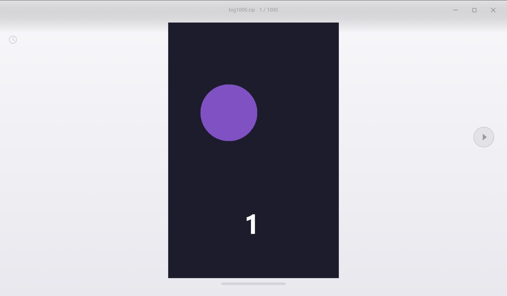

# comic++

跨平台看图 / 看漫画的桌面阅读器。Rust 原生自绘（winit + wgpu + egui），无标题栏、按平台切换的
窗口按钮、底部拉手式缩略图抽屉，重点优化「上千页压缩包快速翻页不掉帧」。



## 为什么不是 Go，而是 Rust

Go 做「好看」的这类 app 有三个硬伤：

1. **自绘 GPU/系统级模糊做不到。** Fyne 是软件光栅（CPU 画），Gio 也是 CPU/OpenGL 自绘且没有
   毛玻璃 API；要真正的 Acrylic / NSVisualEffectView 只能靠 CGO 绑系统窗口句柄，绕一大圈还跨不了
   平台。Wails / webview 壳本质是浏览器渲染，大图、超长图的纹理上传和合成全卡在 WebView 里。
2. **解码慢。** Go 标准库 `image/*` 是纯 Go 实现，没有 SIMD，也没有 webp/avif/heic 解码。
   一张 4K 图解码几十毫秒起步，翻页就会抖。Rust 侧 zune-jpeg（SIMD）解码快 3~10 倍，image crate
   直接支持 png/jpeg/gif/webp/tiff/bmp/tga/qoi…，还能多线程并行。
3. **压缩包读取弱。** Go 的 `archive/zip` 只支持 zip，且 API 是顺序流式的，随机跳到第 800 页要么
   重新遍历要么自己解析中央目录。

Rust 的优势正好补上：`zip` crate 按 central directory 随机访问；`sevenz-rust2` 纯 Rust 解 7z；
wgpu 一套 API 覆盖 DX12 / Metal / Vulkan。所以选型：**Rust + 原生窗口自绘，不用 Tauri/WebView**。

## 已实现

- **窗口外观完全交给系统，不自绘**：保留标准窗口样式，只把标题栏那块非客户区去掉（相当于参考项目
  mygo 的 `frameCalcSize` 里还原 `Rgrc[0].Top`），再留 1px 非客户区（等价 mygo 的
  `DwmExtendFrameIntoClientArea{Top:1}`「用一个像素的 frame 把阴影带回来」）。圆角和投影都是 Windows 11
  DWM 给的，代码里没有一笔是手画的。`DWMWA_USE_IMMERSIVE_DARK_MODE` 与 `DWMWA_BORDER_COLOR` 跟随
  当前主题：深色时是黑底 + 近黑描边，浅色时是浅底 + 半透明深色描边（DWM 的 `COLORREF` 不吃 alpha，
  这里用与浅底预混的深灰模拟，两端都不会冒出系统那条灰白细线）。
- **浅色 / 深色两套主题**：默认浅色（`#F1F1F5` 底 + 极淡的竖向渐变），深色是原来的暗房基调。
  **在画面空白处点右键即可切换**（标题栏、底部拉手、左侧最近面板、整页图本身除外）。
- 无标题栏，窗口按钮按平台走：**macOS** 是左侧三个红绿灯（hover 才露 ×/−/⤢）；**Windows / Linux**
  是右上角 — □ ✕ 三键，hover 才出 7px 圆角底色、关闭键 hover 变红。顶栏空白处拖动窗口，
  四边/四角可拖拽 resize（7px 热区，自动切换光标）。
- 左上角时钟按钮**正上方还有一个「+」**，点一下直接弹打开对话框（没打开书时也在）。
- 画面区：整页图直角、无描边，只有一层极淡的投影（浅色 alpha 20、深色 58，向下偏 5px）；深色主题下
  页面中心另有一圈极淡的径向柔光（egui 没有原生径向渐变，用三角扇多环网格拼的）。
- 鼠标贴左右边缘浮出圆形翻页钮（46px，浅色是白底、深色是玻璃底），第 1 页不显示左钮、最后一页不显示右钮。
- **底部拉手 + 缩略图抽屉**：常驻一条 6px 高的圆头横条，宽度为窗口宽的 13%（60–150px），默认 20%
  不透明度，划过或按住拖动时 80%（浅色下是黑条、深色下是白条，保证两边都看得见）。往上拉，白条与窗口
  底的距离决定缩略图的高度和范围——窗口尺寸不变，上面的画面同步缩小；松手不到 92px 弹回，双击在
  0 与半开之间切换。抽屉里**没有任何玻璃底、底板或描边**，缩略图直角直接浮在背景上，各自只带一点
  投影；**当前页那张的投影明显更大一圈也更深**，其余的很轻。
- 缩略图未选中的压到 66% 亮度（浅色下 86%，免得灰成一片），hover 上浮 3px，当前页给满亮度；
  横向滚动带惯性（阻尼 0.92）。
- **左侧「最近打开」**：左上角一个时钟按钮，点开竖排显示最近 6 条记录（图片 / 压缩包 / 文件夹都认），
  每条一行：首图封面、类型和文件名；窗口矮的时候可以在列表上滚轮。点条目直接切书，底下缩略图跟着重载。
  记录落盘到 `%LOCALAPPDATA%\comicpp\recent.txt`，启动就恢复。
- **封面磁盘缓存**：封面按「路径 + 修改时间 + 大小」哈希存到 `%LOCALAPPDATA%\comicpp\covers\<hash>.png`
  （240px 宽的小图），命中就直接读小图，不再重解；目录只保留最近 100 张，自动淘汰最老的。7z 这种
  首开要解包的，第二次启动封面也几乎瞬间出来。
- 键盘翻页、滚轮翻页、拖放文件/文件夹打开、Ctrl+O 文件对话框。
- 自然排序（`1.jpg 2.jpg ... 10.jpg`），文件夹书源递归。

## 支持格式

| 书源 | 说明 |
| --- | --- |
| 文件夹 | 递归收集图片 |
| 单张图片 | 打开时会把同目录里的其他图片一起排成序列，直接停在你点的那张上，上下翻页/底部缩略图都能用 |
| `.zip` / `.cbz` | central directory 随机访问，按页 inflate |
| `.7z` / `.cb7` | 首次打开整包解压到 `%LOCALAPPDATA%\comicpp\sz\<hash>`，之后按本地文件随机读 |

图片：jpg / jpeg / jfif / png / webp / gif / bmp / tif / tiff / tga / jp2 / qoi。

## 快捷键

| 键 | 动作 |
| --- | --- |
| `←` `PageUp` | 上一页 |
| `→` `PageDown` `Space` | 下一页 |
| `Home` / `End` | 第一页 / 最后一页 |
| `Ctrl+O` | 打开文件 |
| 滚轮（非底部热区） | 翻页 |
| 拖入窗口 | 打开 |
| 空白处右键 | 浅色 / 深色主题切换 |

## 性能（实测，1000 页 zip，600×900 JPEG，包 6.95 MB，release 构建）

连续翻页（每 3 帧换一页，约 20 页/秒，远严苛于真人手速）：

```
frames=9400 avg_ms=16.42 worst_ms=17.04 page=1000/1000
```

16.5ms/帧是被 vsync 钉住的 60fps 上限，worst 也压在 17ms 以内 —— **从第 1 页连翻到第 1000 页，
全程满帧，没有一次 1 秒级的卡顿尖峰**。debug 构建同样场景是 30~130ms 并有 1s 尖峰，所以务必用
release 跑。

冷启动后第一次预取那几页会有一两帧 25~40ms（解码线程还在抢 CPU），稳定后就是满帧。

7z 同样 1000 页：首开 2.1 秒（含解压落盘），之后与 zip 一致。

## 为什么上千页也不卡

1. **绝不整包解压。** zip 里每页单独 inflate，每个解码线程各持一个 `ZipArchive` 句柄（按路径
   切换时重建），避免中央目录重复解析和锁竞争。
2. **解码池按核数开。** 线程数 = CPU 核数 − 1，clamp 2..=6。
3. **两级任务 + 代际取消。** `Full`（整页，受 generation 约束：一翻页旧任务立刻作废，绝不占用
   算力在已经看不到的页上）与 `Thumb`（缩略图，只在换书时作废）。同一个页码在飞行中不重复排队。
4. **预取窗口。** 整页预取当前页 ±4，缩略图先取当前附近 ±40 再顺序补齐。
5. **显存不爆。** 整页纹理只保留当前页 ±9，超出的立即 `free_texture`；缩略图走独立 LRU。
6. **主线程只做 drain + upload。** 解码结果从 channel 收，每帧只 load 一次纹理，不阻塞渲染。

## 构建

```powershell
cd "E:\000 app\comic++"
cargo build --release
.\target\release\comicpp.exe "D:\comics\xxx.cbz"
```

跨平台：Windows / macOS / Linux 同一套代码，无平台特定渲染代码；只有字体路径、DWM 调用和 7z/封面
缓存目录按平台取值（Windows `LOCALAPPDATA`、其他 `TMPDIR`）。

自带一个压测开关：

```powershell
.\target\release\comicpp.exe "testdata\big1000.zip" --auto
# 每 3 帧自动翻一页，每 40 帧往 testdata\perf.txt 追加 avg/worst 帧时间
```

## 代码结构

```
src/main.rs   winit 事件循环 + wgpu surface + egui 集成 + DWM 主题/描边 + 平台窗口按钮动作 + 边缘 resize + 压测
src/book.rs   书源抽象（Dir / Zip / SevenZ），自然排序，单页随机读取，单张图片当一页
src/decode.rs 解码线程池，Full/Thumb 两级任务，代际取消，in-flight 去重
src/ui.rs     自绘 UI：浅/深主题取色、平台化窗口按钮、直角页面、边缘翻页钮、拉手抽屉、最近记录面板、封面磁盘缓存
```

## 已知限制

- `.rar` / `.cbr` 未支持（RAR 是私有算法，纯 Rust 没有可靠实现；需要时先解压或转 zip）。
- 7z 首次打开会同步解压整包，几百 MB 的包首开会黑屏一会儿（有磁盘缓存，第二次秒开）。
- 缩略图只有内存缓存，重启后重新生成；封面才有磁盘缓存。
- 暂无缩放 / 平移 / 双页跨页模式。
